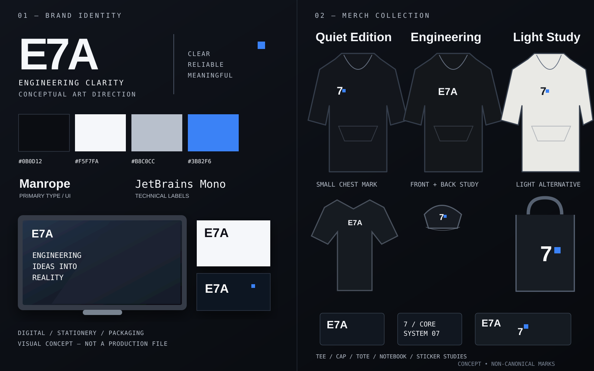

# E7A Merchandise — концепции и референсы (включая худи)

**Статус:** арт-дирекшн / concept briefs, **не** готовый товар, склад, производственный макет или утверждённый merchandising release. Геометрию брать из Core assets, палитру — из tokens.css. Изображения и реальные образцы предстоит утвердить отдельно.

## Визуальные мокапы

[Векторная доска с Quiet Edition / Engineering Edition / Light Study и дополнительными носителями](references/e7a-brand-reference-board.svg) · [Пояснения и источники](references/README.md). На схеме символы условные, для финальных макетов обязательны исходники Core; физические образцы ещё не изготовлены.

## 01 — Essential Hoodie (основной обязательный концепт)

| Параметр | Референс-направление, требует образца |
| --- | --- |
| Силуэт | Унисекс, умеренно свободный, плотный хлопковый или хлопковый смесовый трикотаж; учитывать усадку/посадку и размерную сетку |
| База | Тёмный почти-чёрный ориентир #0B0D12, проверяется по реальной ткани |
| Перед | Маленький точный E7AMark (геометрическая 7 с blue node) слева на груди **или** короткий E7A wordmark, без двух конкурирующих крупных логотипов |
| Спина | Крупный E7AMark, ориентированный по центральной оси спины; альтернативно чистая спина для тихого варианта |
| Рукав | Малая техническая подпись SYSTEM 07 или короткая фирменная метка — только после проверки визуальных и brand rights |
| Техника | Вышивка/шелкография/трансфер выбираются после физической пробы node, диагоналей, стоимости, износа и контраста |
| Акцент | Синяя balance point #3B82F6; цвет нити/краски только после цветопробы |
| Предназначение | Первая ограниченная команда/сообщество; коммерческое производство — отдельное решение |

**Референс-макет A — Quiet Edition:** почти полностью тёмное худи; маленькая семёрка на левой груди и без крупной спины; акцент — только синяя точка. Подходит сотрудникам, пользователям, разработчикам и B2C-мероприятию.

**Референс-макет B — Engineering Edition:** тёмное худи; чистый E7A wordmark на груди, одна большая пропорционально верная семёрка на спине, небольшая SYSTEM 07 на рукаве. Не перегружать печатью/кодом/сетками; контраст и стойкость проверять.

**Референс-макет C — Light Study (неприоритетный):** светлая/off-white ткань как физическая проба; знак и тексты контрастным тёмным, blue node сохраняет роль акцента. Палитра изделия отдельно утверждается; менять фирменный CSS токен фона сайта нельзя.

### Критерии запуска первого худи

1. Дизайнер использует официальный векторный asset/экспорт из E7AMark с точным source SHA; никакой перерисовки по памяти.
2. Зафиксировать 2D-мокап на переде/спине/рукаве и сделать test-size prints/embroidery.
3. Проверить ткань, посадку, швы, размерную сетку, устойчивость печати после стирки, возможные дефекты, уход и качество; получить физический sample.
4. Проверить права на производство, согласование бренд-материалов, third-party vendor NDA/access, лицензии шрифтов и согласовать тираж/budget.
5. Только после owner approval — производственный файл, спецификация качества и пилотная партия. **Нет автоматической публикации магазина или заказов.**

## 02 — T-shirt

**Reference:** плотная тёмная футболка с уменьшенной E7ALogo на груди, один E7AMark на спине сверху. Альтернатива — светлая базовая ткань с тёмным знаком. Учитывать размер и доступность/контраст, не брать неподтверждённые цвета.

## 03 — Cap

**Reference:** сдержанная шестипанельная кепка, одна геометрическая семёрка спереди, возможно минимальная blue node; технический тест вышивки на маленьком размере обязателен, тонкие линии не должны исчезать.

## 04 — Tote / Laptop sleeve

**Reference:** монохромный шоппер/чехол с одним крупным знаком и небольшим E7A идентификатором; зона ношения без избыточных слоганов. Крепление/обработку ткани проверить.

## 05 — Developer kit / notebook / stickers

**Reference:** блокнот #0B0D12 со светлым E7AMark, стикеры из mark+node и карточка с краткими принципами E7A; подпись SYSTEM 07 допускается как текстовый элемент из сайта, но не означает новый зарегистрированный знак.

## Где хранить источники

Канонические исходники — [Core UI](https://github.com/E7A-RU/core/tree/main/packages/ui) и branding assets, брендовая политика — [.github/BRAND_POLICY.md](../BRAND_POLICY.md). **Brandbook не дублирует SVG в отрыве от Core и не держит font files.** Для каждого утверждённого SKU в будущем: design revision, source asset SHA, vendor/spec, approval, colour proof, stock/legal/rights status, размеры, фотографии sample с разрешением.

## Дальнейшие действия, не выполняемые этим документом

Создать визуальные мокапы основных трёх вариантов худи и двух дополнительных носителей; провести sample review и закрепить один official merchandise SKU. Фактических изображений изделий и утверждённых производственных файлов в этом документе пока **нет** — только арт-дирекшн для дизайнера.

См. [Brandbook](README.md) и [Product/Growth roadmap](../governance/growth-strategy-and-first-milestone.md).
## Связанный цифровой носитель: Stickerpack E7A

Помимо физических вещей, отдельным обязательным проектом брендбука является [оригинальный E7A Stickerpack](stickerpack.md) (12 первых стикеров, затем расширение, вариант public и staff); для печати sticker sheets и продажи merchandising требуется отдельный товарный/правовой workflow. Фирменные исходники — Core, права — отдельный legal review.

До коммерческой продажи худи/футболок обязательно проверить применимость [требований к маркировке, подтверждению соответствия, дистанционной торговле и налоговому статусу в РФ](../legal/product-compliance-russia.md); НПД может быть недоступен для маркируемой одежды.
