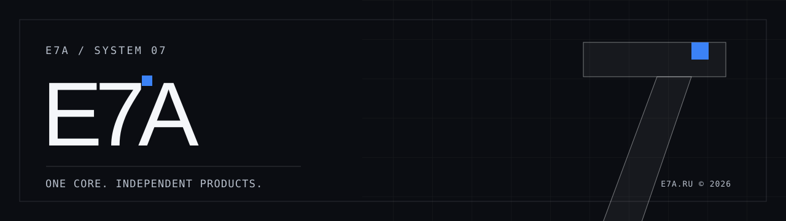

  

 

**E7A — инженерная экосистема цифровых продуктов.** Мы создаём интерфейсы и системы, в которых сложность остаётся в архитектуре, а контроль — у человека.

[**e7a.ru ↗**](https://e7a.ru) · [**О проекте**](https://e7a.ru/about) · [**Системный подход**](https://e7a.ru/system)

---

### 01 / Один фундамент. Самостоятельные продукты.

Общее ядро задаёт визуальный язык, типизированные контракты и проверяемый старт нового приложения. Каждый продукт сохраняет собственные данные, безопасность, выпуск и возможность отката.

| Продукт | Назначение | Статус |
| :--- | :--- | :--- |
| **E7A** · [e7a.ru](https://e7a.ru) | Основной сайт и точка входа в экосистему | Работает |
| **Bot Studio** · [bot.e7a.ru](https://bot.e7a.ru/studio) | Сценарии ботов, API и оркестрация сообщений | Работает; развитие продолжается |
| **Reader** · [reader](https://github.com/E7A-RU/reader) | Чтение электронных книг в выбранном темпе | Исходники MVP готовы; развёртывание не подтверждено |
| **Core** · [core](https://github.com/E7A-RU/core) | Единые компоненты, контракты, CLI и шаблоны | Публичный UI 0.2.1 опубликован в npm; Server остаётся приватным |

### 02 / E7A Core

[**`@e7a-ru/ui@0.2.1`**](https://www.npmjs.com/package/@e7a-ru/ui) — публичная npm-библиотека типографики, дизайн-токенов, React-компонентов и геометрии бренда; скачивается без токенов. Публикация подтверждена в [релизной задаче](https://github.com/E7A-RU/core/issues/24) (страница GitHub Core доступна участникам репозитория).  
`@e7a-ru/server` — приватные серверные контракты и утилиты: опубликована версия 0.1.0, версия 0.2.0 ещё проходит отдельную процедуру выпуска.  
**Product Starter** — воспроизводимый каркас Next.js/React/TypeScript и опционального Node API.

Мы придерживаемся принципа **одна дизайн-система / независимые репозитории / фиксированные версии / проверяемые релизы**. Новые версии библиотек предлагаются продуктам отдельными PR с помощью Dependabot; проверки проходят локально или на Lobachevsky, автоматические деплои по факту публикации Core не выполняются.

### Фирменный стиль E7A

**Использование названия E7A в качестве чужого бренда, официального логотипа, символа и других фирменных материалов без предварительного письменного разрешения правообладателей запрещено.** Публичная загрузка `@e7a-ru/ui` не является лицензией на брендинг или стороннее использование кода. Условия и исключения: [E7A Brand Usage Policy](../BRAND_POLICY.md).

[**Визуальные концепты мерча и брендбука**](../brandbook/references/README.md) — неофициальные условные макеты, не утверждённые товары и не лицензия на фирменную айдентику.

### 03 / Единая архитектурная философия

[**E7A Governance — канонический стандарт экосистемы**](../governance/README.md): Core как SDK, Laboratory как Wizard/QA/Release Gate, Infra как среда исполнения, будущая Identity как единый реестр зарегистрированных субъектов, Platform как будущий backend-as-a-service (СГДС, Jobs, Connectors, Results). Все продукты сохраняют собственные бизнес-данные и релизы. Изменения проходят self-hosted проверки и отдельное разрешение владельца; документируемая концепция не является развернутым runtime.

### 04 / Как мы строим

`TYPECHECK` → `BUILD` → `TEST` → `AUDIT` → `RELEASE GATE`

Готовность подтверждается проверками и реальной эксплуатацией, а не наличием папки с исходным кодом. Секреты, базы и среда исполнения продуктов не объединяются.

---

  E7A / SYSTEM 07 · ясность структуры, уважение к вниманию, управляемая сложность.

### Продукты, аудитория и визуальная идентичность — стратегическое направление

**B2C — первый фокус, B2B — второе направление.** Будущая цель E7A — дать посетителю понятный путь от знакомства до проверки полезного цифрового продукта и обратной связи; маркетинговые сценарии и demo rollout ещё проходят проектирование. [Целевая стратегия M1](../governance/growth-strategy-and-first-milestone.md) · [Брендбук и фирменные носители](../brandbook/README.md), включая концепции худи (ещё не производство). Публичная Brand Policy и права на код остаются самостоятельными правилами.
