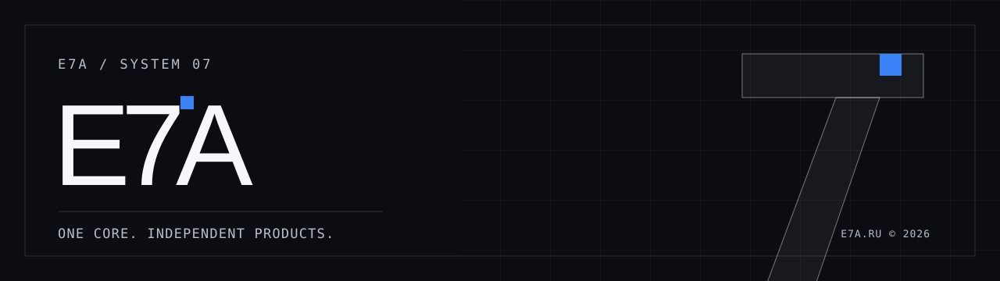

<div align="center">

  

  <h1>E7A</h1>
  <h3>Проектируем, разрабатываем и развиваем полезные цифровые продукты</h3>
  <p><strong>B2C-first · B2B automation · Engineering-first</strong></p>
  <p>Единая система инженерных принципов — самостоятельные продукты, понятные границы ответственности и релизы, которые можно проверить и безопасно откатить.</p>
  <p>
    <a href="https://e7a.ru">Веб-сайт E7A</a> ·
    <a href="#продуктовая-линейка">Наши продукты</a> ·
    <a href="https://github.com/E7A-RU/.github/tree/main/governance">Governance</a> ·
    <a href="https://github.com/E7A-RU/.github/blob/main/governance/roadmap.md">Roadmap</a>
  </p>
</div>

---

## E7A Core UI — проверенный публичный релиз

Общая дизайн-система [`@e7a-ru/ui@0.5.0`](https://www.npmjs.com/package/@e7a-ru/ui/v/0.5.0) опубликована и проверена в npm 18 ноября 2026 года. В ней представлены утверждённые SVG E7A Wordmark v3. **Поддерживаются 0.5.0 и 0.4.0 (предыдущая, ограниченная)**; версии до 0.4.0 — архивные, неподдерживаемые, хотя исторические опубликованные пакеты остаются доступными. Нормальное окно поддержки — текущий и один предыдущий minor, максимум два предыдущих по отдельному временно ограниченному решению владельца. [Политика версий](https://github.com/E7A-RU/.github/blob/main/CORE_UI_SUPPORT.md). Выпуск библиотеки не обновляет сами продукты; использование бренда третьими лицами требует разрешения правообладателя.

## Как познакомиться с E7A

| Для кого | С чего начать |
| :--- | :--- |
| **Пользователям** | [e7a.ru](https://e7a.ru) — публичная точка входа; изучите направления и следите за доступностью конкретных продуктов |
| **Командам и заказчикам** | [Наш подход к B2B-автоматизации](https://github.com/E7A-RU/.github/blob/main/governance/market-positioning-and-entrypoints.md) и [контролируемым Demo](https://github.com/E7A-RU/.github/blob/main/governance/demo-and-trials.md) |
| **Разработчикам и партнёрам** | [Product Lifecycle](https://github.com/E7A-RU/.github/blob/main/governance/product-lifecycle-checklists.md) · [три Product Kit](https://github.com/E7A-RU/.github/blob/main/governance/kit-implementation-roadmaps.md) · [Governance](https://github.com/E7A-RU/.github/tree/main/governance) |

*E7A combines independent software products, shared engineering standards and human-approved releases. Our public documentation distinguishes shipped capabilities from proposals and prototypes.*

## Что мы создаём

| **Продукты для людей** | **Автоматизация для бизнеса** | **Инженерный фундамент** |
| :--- | :--- | :--- |
| Удобные пользовательские инструменты, чтение, планирование, игровые гипотезы | Диалоги, боты, интеграции, повторяемые бизнес-процессы | Общая дизайн-система, типизированные контракты, безопасность, управляемая инфраструктура |

Опубликован Governance 4.0.0; [release descriptor](https://github.com/E7A-RU/.github/blob/main/governance/standards-release.json) фиксирует нормативную ревизию. Продукты принимают изменения адресно: версия организационного стандарта не доказывает готовность сервиса или миграцию всех потребителей. Мы не сводим экосистему к единственному серверу или универсальному backend. Каждый продукт сохраняет **свои данные, свой релиз и собственную ответственность**, а общие возможности подключает по контрактам тогда, когда они действительно нужны.


## Продуктовая линейка

**Сведения сверены 18.11.2026.** Публичные метаданные Website и Reader проверены отдельно; описание остальных направлений не является live-проверкой их runtime.

### Пользовательские продукты и направления

| Продукт | Для чего | Текущий публично заявляемый этап |
| :--- | :--- | :--- |
| **[E7A Website](https://e7a.ru)** | Главная точка входа: каталог, знакомство с продуктами, будущие Demo и B2B-запросы | Существующий сайт; новые сценарии внедряются отдельно |
| **[Reader](https://reader.e7a.ru/)** | Быстрое, приватное чтение своих документов прямо в браузере | Публичный Reader 0.1.4; локальная обработка документов в браузере |
| **[Bot Studio](https://github.com/E7A-RU/bot)** | Создание диалогов и сценариев бизнес-автоматизации | Существующий Bot runtime; Studio и общие интеграции развиваются |
| **[Planner](https://github.com/E7A-RU/planner)** | Рабочие графики, задачи, календари и планирование | Разработка в отдельном Draft; публичный выпуск не подтверждён |
| **[Gateway](https://github.com/E7A-RU/gateway)** | Контроль доступа устройств к личному WireGuard-шлюзу | TypeScript/PostgreSQL исходники в разработке; не подтверждён как запущенный продукт |
| **[Games](https://github.com/E7A-RU/.github/blob/main/governance/games-product-direction.md)** | Направление браузерных и небольших мобильных игр; будущая витрина | Зарегистрированное направление, без анонса готовой игры |

*Многие репозитории приватны: переход по ссылке доступен только участникам с правами. Указанный статус не является заявлением о доступности конкретной функции прямо сейчас.*

### Основа экосистемы

| Компонент | Зона ответственности | Фактическая граница |
| :--- | :--- | :--- |
| **[Core](https://github.com/E7A-RU/core)** | Дизайн-система, React UI, typed SDK/contracts, необязательный Product Starter | Не backend и не центральная БД. Публичный `@e7a-ru/ui@0.5.0` подтверждён в npm 18.11.2026; adoption у продуктов отдельный |
| **[Identity](https://github.com/E7A-RU/identity)** | Person / Account / Organization / Workspace, Product Trust, централизованные grants и OIDC | Реализация и эксплуатационная приёмка развиваются; готовность для реальных пользователей не заявляется |
| **[Platform](https://github.com/E7A-RU/platform)** | Delivery/СГДС, trusted Jobs, Connectors, Results | Самостоятельная Foundation capability, ещё не RUNNING |
| **[Laboratory](https://github.com/E7A-RU/laboratory)** | Product Factory: Wizard, три Product Kit, QA, Sandbox, Release Gate | Планируемый продукт, не универсальный backend |
| **[Infra](https://github.com/E7A-RU/infra)** | Инвентарь серверов, окружения, секреты, backup/recovery, контролируемые релизы | Отдельная эксплуатационная граница; общая платформа ещё не подтверждена |
| **[Central Audit / Billing Foundation](https://github.com/E7A-RU/.github/blob/main/governance/roadmap.md)** | Защищённый аудит; тарифы, заказы, подписки, entitlements | Утверждённые архитектурные направления, не готовые платежи |
| **[Engineering Automation](https://github.com/E7A-RU/automation)** | Приватный внутренний проект: стандарты, планирование обновлений и безопасная подготовка Draft PR | Read-only наблюдение и подготовка предложений; наличие observer не даёт прав на запись, merge или deployment |
| **E7A Admin Template** (private) | Самостоятельный повторно используемый шаблон UI административных интерфейсов для внутренних и будущих клиентских продуктов | Спецификация и отдельный синтетический прототип; готового приложения или публичного пакета нет |

## Принципы разработки

| | Наш подход |
| :--- | :--- |
| **01 — Product ownership** | Каждый продукт владеет бизнес-данными, ресурсным жизненным циклом и применяет проверку доступа; экосистемные grants и роль-модели централизуются через Identity после адресного внедрения. Общей бизнес-БД нет |
| **02 — TypeScript / PostgreSQL** | TypeScript-first; для stateful backend предпочтителен PostgreSQL с независимой продуктовой БД, проверяемыми SQL-миграциями и восстановлением |
| **03 — Privacy & security** | Отдельные субъекты Person / Account / SecurityActor, минимальные полномочия, независимые границы доверия, no secrets in Git |
| **04 — Reusable, not coupled** | Core выпускает пакеты и контракты; Identity, Platform, Infra и Laboratory не подменяют друг друга |
| **05 — Evidence before release** | Исходники ≠ пройденные тесты ≠ работающее production. Каждое утверждение о готовности требует подтверждения |
| **06 — Human control** | Изменения глобальных правил утверждает владелец; production без отдельного разрешения не меняется |

### Три пути создания нового продукта

| Kit | Типичная задача | Данные и runtime |
| :--- | :--- | :--- |
| **[Browser-only](https://github.com/E7A-RU/.github/blob/main/governance/kit-implementation-roadmaps.md)** | Reader, локальное приложение или браузерная игра | Работает в браузере; сервер, учётная запись и PostgreSQL **не обязательны** |
| **[Full-stack](https://github.com/E7A-RU/.github/blob/main/governance/kit-implementation-roadmaps.md)** | Продукт с собственными API и состоянием | TypeScript frontend/backend + продуктовая PostgreSQL, если требуется долговременное хранение |
| **[Service / Worker](https://github.com/E7A-RU/.github/blob/main/governance/kit-implementation-roadmaps.md)** | Интеграции, события, фоновые операции | Версионированные контракты, идемпотентность, retries, Results и PostgreSQL при durable state |

**Стандартный процесс:** идея → Product Charter → Kit и ADR → реализация → локальная/self-hosted QA → staging при необходимости по риску → разрешённый product-scoped выпуск (standing authorization для допустимых R0/R1 либо отдельный approval) → наблюдение и безопасный повторный релиз.

[**Product Lifecycle Checklists**](https://github.com/E7A-RU/.github/blob/main/governance/product-lifecycle-checklists.md) · [**Backend Reference Architecture**](https://github.com/E7A-RU/.github/blob/main/governance/backend-reference-architecture.md) · [**Product Charter Template**](https://github.com/E7A-RU/.github/blob/main/governance/templates/product-charter.md)

## Roadmap: от фундамента к пользовательской ценности

```text
GOVERNANCE  ── единые архитектурные правила и границы ответственности
      ↓
FOUNDATION F1 ── проверенная интеграция необходимых общих capabilities
      ↓
FOUNDATION F2 ── восстановление, безопасность и эксплуатационная готовность
      ↓
M1 PRODUCT-IN-USE ── реальное использование + обратная связь + повторный релиз
```

Разработка Website и проверка B2C-гипотез происходят параллельно техническому Foundation. **Reader и Games — кандидаты**, а не автоматически назначенные первые флагманы. [Подробный Roadmap →](https://github.com/E7A-RU/.github/blob/main/governance/roadmap.md)

## Инженерная открытость и границы доступа

Мы публикуем [организационные стандарты](https://github.com/E7A-RU/.github/tree/main/governance), [roadmap](https://github.com/E7A-RU/.github/blob/main/governance/roadmap.md) и [визуальные концепты](https://github.com/E7A-RU/.github/tree/main/brandbook). При этом исходники отдельных продуктов, данные и операционные настройки могут оставаться приватными: **открытая архитектура не означает открытый доступ к внутренней инфраструктуре**.

Версии стандартов имеют неизменяемый SHA. Обновления предлагаются продуктам через отдельные PR; это не запускает массовую публикацию, пересборку или деплой. За производственным выпуском и изменением глобальных правил остаётся человеческое решение.

## Открытая инженерная документация

- [**Governance**](https://github.com/E7A-RU/.github/tree/main/governance) — организационные решения и границы компонентов
- [**Brandbook**](https://github.com/E7A-RU/.github/tree/main/brandbook) — визуальные принципы и концептуальные референсы
- [**Standards & change control**](https://github.com/E7A-RU/.github/blob/main/governance/standards-and-change-control.md) — версионирование глобальных правил, review, ADR и обновление потребителей
- [**E7A Automation**](https://github.com/E7A-RU/.github/blob/main/governance/engineering-automation.md) — правила внутреннего наблюдения и подготовки предложений; writer требует отдельного допуска
- [**E7A Brand Usage Policy**](https://github.com/E7A-RU/.github/blob/main/BRAND_POLICY.md) — использование имени, логотипов и фирменных материалов сторонними лицами допускается только по предварительному письменному разрешению правообладателей; публичность библиотеки не предоставляет лицензию на исходный код

---

<div align="center">

**E7A · Технологии, которые можно понимать, проверять и развивать.**

[Сайт](https://e7a.ru) · [Roadmap](https://github.com/E7A-RU/.github/blob/main/governance/roadmap.md) · [Governance](https://github.com/E7A-RU/.github/tree/main/governance)

</div>
